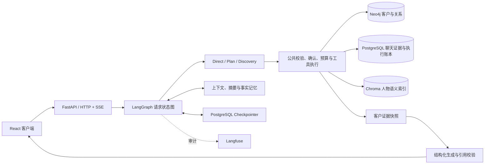

# 知客-销售沟通助手

**用自然语言维护客户资料，用聊天证据准备下一次沟通。**

知客是基于 LangGraph 的销售辅助 Agent：把分散的客户档案、关系和模拟聊天整理为可查询的资料与沟通准备单。每条客户事实尽量附上可查看的原文依据，帮助销售在联系客户前了解背景、回顾需求与约定。

[快速开始](#快速开始) · [架构与源码](docs/ARCHITECTURE.md) · [评测与样例](docs/evaluations/showcase/README.md) · [文档导航](docs/README.md)

> 当前定位：可本地运行的个人项目与工程实践。已实现模拟聊天导入；真实企业微信接入仍在设计中。现有评测发现的失败和待审项均保留，不将项目表述为已通过生产验收。

## 两个核心场景

### 1. 自然语言维护客户资料与关系

```text
用户：我有个客户叫杨鑫，是泛微科技销售部负责人，出生于1998年。
用户：把杨鑫的职业改为销售负责人，另外查一下张建国的爱好。
```

Agent 根据真实工具结果查找人物、处理同名歧义、保存资料与关系。修改和删除进入确认流程；已完成的工具调用通过请求账本与业务回执复用。

### 2. 根据聊天证据生成销售沟通准备

```text
用户：我明天要联系杨鑫，帮我根据客户聊天证据准备一下。
```

准备单包含客户背景、近期沟通与需求、上次约定、建议询问的问题、开场白和信息缺口。事实与建议分开展示，事实附 `source_id + quote`；“查看依据”可打开聊天原文或取证时的档案快照。

没有明确后续记录的约定保持 `UNKNOWN`。资料不足、检索截断或校验失败时，明确说明限制。

## 工程实现

| 能力 | 实现方式 |
|---|---|
| Agent 编排 | LangGraph `StateGraph`、`Command` 路由、`interrupt` 人机交互 |
| 工具决策 | Direct 原生工具循环；Plan 目标拆解与依赖计划；Discovery 作为实验性工具发现方案 |
| 安全执行 | Pydantic 参数校验、服务端注入身份、`owner_id` 隔离、更新/删除确认 |
| 幂等与恢复 | `request_id` 请求账本、`call_id` 执行记录、Neo4j 业务回执及 PostgreSQL Checkpointer |
| 执行预算 | 累计模型调用、工具尝试、Token、重规划、澄清次数和活跃时间预算 |
| 记忆与上下文 | 最近消息、结构化滚动摘要、长期事实；上下文预算、人物焦点与后台记忆任务 |
| 沟通准备 | 按客户和时间筛选证据、结构化生成、逐字引用校验与来源快照 |
| 流式体验 | LangGraph 流 + SSE，展示阶段进度、工具状态与回复；断线重连及事件去重 |
| 审计与评测 | Langfuse 回调/实验接口、本地逐例记录、外部状态评分和真实数据库恢复实验 |

销售准备目前仅支持 Direct 入口。工具调用与确认共用执行边界；三种决策方式不等于三个独立业务 Agent。

## 架构



Neo4j 是客户资料与关系的业务数据源；PostgreSQL 保存对话、客户聊天证据、执行账本、记忆及检查点；Chroma 是可重建的人物语义搜索索引。[详细链路与代码阅读顺序](docs/ARCHITECTURE.md)。

## 快速开始

开发环境建议：**Python 3.12、Node.js 22.12+、Docker Compose、uv**。Python 依赖以 `pyproject.toml + uv.lock` 为准，前端使用 `package-lock.json`。

### 1. 获取代码与配置

```bash
git clone https://github.com/linranranran/ai-relationship-assistant.git
cd ai-relationship-assistant
```

复制 `.env.example` 为 `.env`，至少配置：

- LLM 的 API Key、OpenAI 兼容地址与模型名称；
- Embedding 的 API Key、地址与模型：人物新增或相关属性更新会同步语义索引；
- 本地 Neo4j、PostgreSQL 密码及随机 `SECRET_KEY`。

默认关闭 Langfuse 上报；需要审计时再配置自己的项目并开启。模型调用及 Embedding 可能产生费用。

### 2. 启动本地数据库

```bash
docker compose up -d neo4j postgres
```

等待数据库可用后安装依赖并初始化 PostgreSQL：

```bash
uv sync --locked
uv run python -m backend.db.init_postgres
uv run python -m backend.main
```

后端：<http://localhost:8000>；接口文档：<http://localhost:8000/docs>。Neo4j 控制台：<http://localhost:7474>。

### 3. 启动前端

另开终端：

```bash
cd frontend
npm ci
npm run dev
```

打开前端显示的地址，注册本地测试账号。先建立客户档案，再在“客户沟通准备”面板选择客户，载入[虚构示例聊天](docs/evaluations/sales-preparation/demo-chat.json)、导入并生成准备单。

完整配置、Windows 操作、已有数据库和故障排查见 [本地运行指南](docs/GETTING_STARTED.md)。

## 评测记录

2026-10-14 的冻结实验使用 `qwen3.6-flash`、温度 0、关闭 thinking：

| 项目 | 实测结果 | 解释 |
|---|---:|---|
| 数据集 | 60 个合成案例 | 40 开发 / 20 保留验收；含核心质量及恢复/API案例 |
| 核心图试验 | 180 次，886 次模型请求 | 真实模型与 LangGraph，业务仓储为受控替身 |
| 正向准备单结构生成 | 42 / 45 | 不含预设应拒绝的旧快照请求，不等于语义正确率 |
| 引用来源与逐字合法 | 358 / 358 | 不等于引用必然支持模型结论 |
| 真实 HTTP 小样本 | 4 账号并发，共 8 请求 | 完整回复 P95 15.87 秒；N=8 不代表生产容量 |
| 发布门禁 | **未通过验收** | 保留多要求遗漏、误报完成、额外属性及人工待审项 |

这组数据对应冻结源码，品牌与文档整理没有重新运行付费模型。仓库提供[公开证据包](docs/evaluations/showcase/README.md)，含可复核的成功/失败样例、独立复评分及真实恢复结果；完整本地运行日志和数据库备份不进入 Git。

**原关键词评分存在误判。** 当前以独立复评分和范围说明为准，不将原规则通过率包装成完整业务完成率。[完整结论](docs/评测文档/评测结果与验收结论.md) · [失败与整改](docs/评测文档/失败案例与整改记录.md)。

## 代码导航

```text
backend/
  agent/          # 图、Direct/Plan/Discovery、确认、预算、记忆、流式执行
  sales/          # 聊天导入、证据装配、准备单契约与引用校验
  tools/          # 人物、关系、查询与销售取证工具
  db/             # Neo4j / PostgreSQL / Chroma 及数据库迁移
  routers/        # 认证、对话、SSE、销售导入与原文查询
frontend/src/
  chat/           # 对话、进度、确认/澄清交互
  sales/          # 模拟聊天导入、准备卡片、证据抽屉
scripts/evaluation/ # 真实模型实验、评分、集成与恢复探针
tests/            # 离线回归与 LangGraph 兼容性检查
examples/         # 独立学习脚本；部分会访问模型，不能当离线测试运行
docs/             # 当前指南、架构、评测证据与历史学习记录
```

## 验证与边界

```bash
uv run python -m compileall -q backend scripts
uv run python -m unittest discover -s tests -p "test_*.py"
cd frontend
npm test
npm run lint
npm run build
```

离线验证应使用隔离配置，详见[开发验证](docs/GETTING_STARTED.md#开发验证)。运行真实模型评测请先阅读[评测脚本说明](scripts/evaluation/README.md)，不要将它当成免费单元测试。

- 当前聊天导入为模拟数据；企业微信读取与自动发送尚未实现。
- 当前聊天检索按客户与近期时间窗口筛选，尚未按沟通目标做语义排序。
- 逐字引用、Schema 合法不能证明结论语义正确，仍需事实支持与建议可用性审核。
- 复杂亲属称谓保留为早期探索，不是当前销售主线的承诺。
- 已验证的恢复实验不代表跨库事务原子性或分布式 exactly-once。

后续优先修复多要求完整性与结果表述一致性、补齐事实语义审核，再评估企微接入与证据检索优化。
