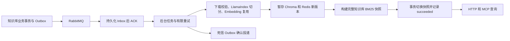

# 知识库事件驱动 RAG 服务

知识库项目管理目录、文件和 OSS，通过 RabbitMQ 发送新增、修改、删除事件；RAG 可靠接收并构建索引，通过 HTTP 和 MCP 提供查询。现有 Tuling-Ai RAG API 和 MCP 代码作为独立基线提交保留。

在本目录 `rag/` 启动依赖，填写 `.env` 中的模型密钥，然后分别启动消费者和 API：

```powershell
Copy-Item .env.example .env
docker compose up -d
uv sync --project rag_api_service
uv run --project rag_api_service python rag_api_service/consume_events.py
# 另开终端，仍在 rag/ 目录
uv run --project rag_api_service python rag_api_service/run.py
# 可选 MCP 代理
uv run --project mcp_service python mcp_service/run.py
```

RAG 查询地址：`POST http://127.0.0.1:8011/api/docs/query`。MCP 地址：`http://127.0.0.1:8010/mcp`。



- **可靠消费**：持久化 Inbox、事件去重、版本防乱序、崩溃恢复、有限退避重试、死信 Outbox 和人工重试。ACK 表示可靠接收，任务 succeeded 才表示可查询。
- **文档更新**：整篇重新解析切分，相同 Embedding 输入复用向量，新 generation 完整后切换查询快照。第 21 个 chunk 失败时，旧版本继续服务。
- **检索一致性**：向量检索在 TopK 前按活动 generation 过滤；BM25 使用同一个不可变快照。默认 jieba、dist_based_score 和原项目的 DashScope 重排。本次改造未重新运行历史 80 题评测。
- **运行边界**：本地 SQLite WAL、单机单索引写入者，API 与 Worker 共享持久化目录；旧 generation 暂时保留，尚未自动回收。多机部署需升级任务数据库、任务认领和共享快照存储。

完整步骤与事件示例见 [本地联调指南](docs/本地联调指南.md)，设计取舍见 [可靠消费设计](docs/可靠消费设计.md)。原 HTTP 摄取路径可通过 `RAG_INGESTION_MODE=legacy` 显式选择；默认事件模式拒绝绕过版本管理的旧写接口。

面试可概括为：“我用 Inbox 和文档版本处理重复与乱序，用不可变索引快照解决跨存储的发布一致性，用内容缓存降低更新成本，再通过持久重试和死信 Outbox 保证失败可恢复。”
